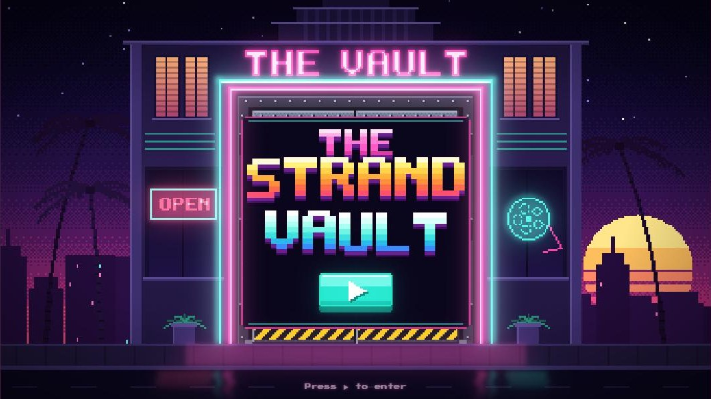
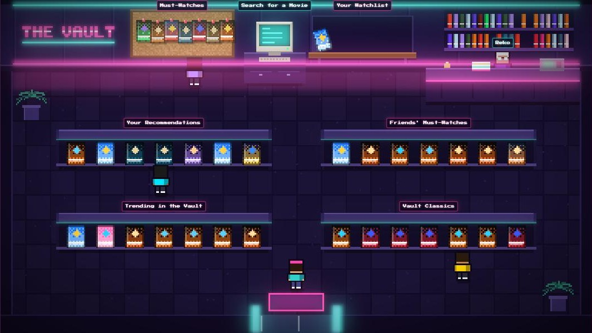
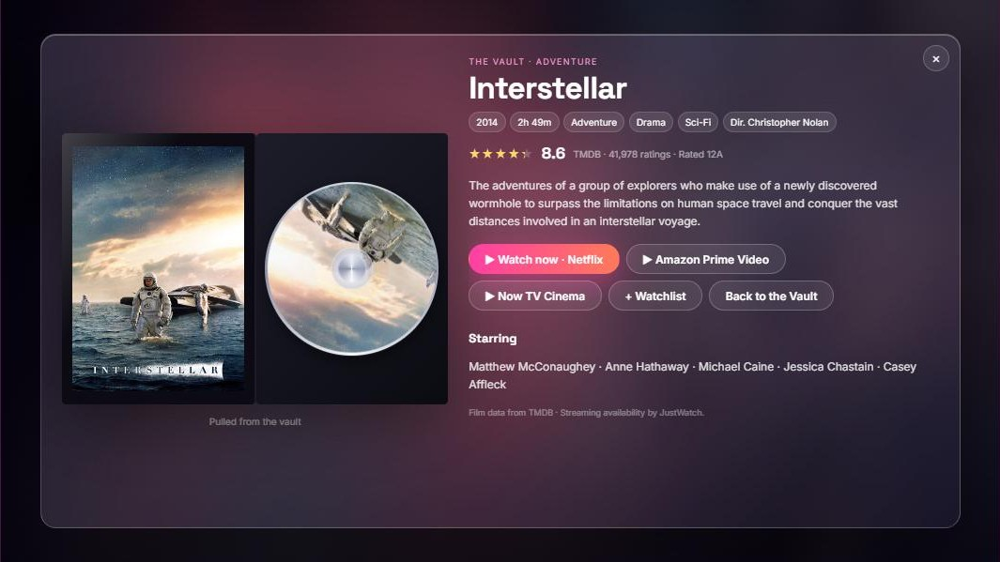
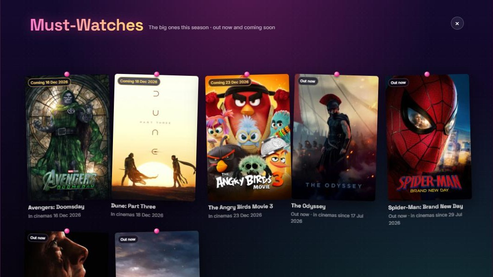
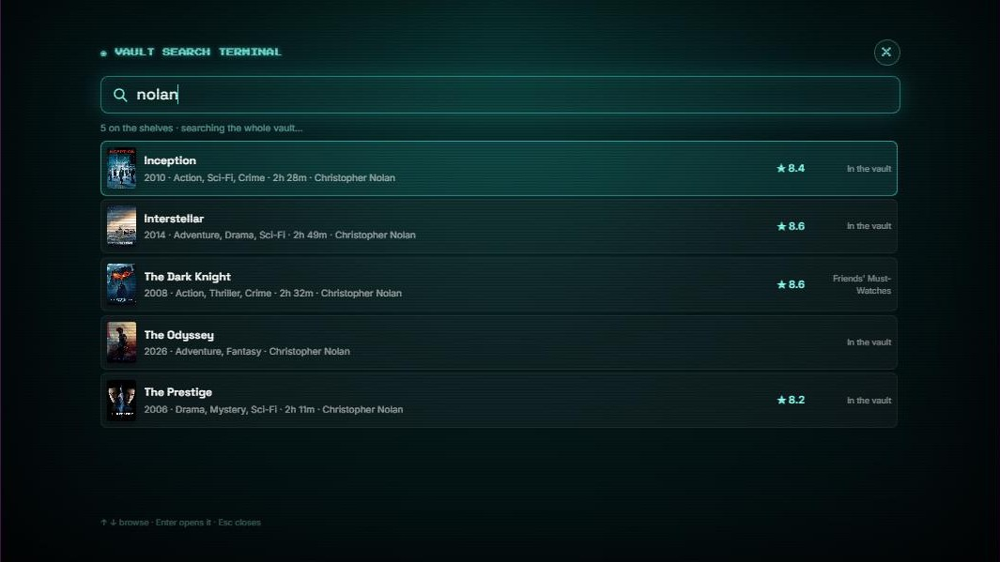

<div align="center">



# THE STRAND VAULT

**A neon 1986 video store that is secretly a streaming guide.**
Walk in, pull a disc off the shelf, and find out exactly where to watch it tonight.
With your friends, live.

[**▶ Play it live: strandvault.vercel.app**](https://strandvault.vercel.app)


*KCL Tech hackathon · Retro Remix + Creative Tech · built agentically with JetBrains Air in IntelliJ IDEA*

</div>

---

## Step inside



The vault door spins open, you walk a neon corridor, and you're on the shop floor. **Click anywhere to walk** (or use the arrow keys). Every shelf is alive:

| | |
|---|---|
| 🎯 **Your Recommendations** | Picked by our own streaming-style recommender, from what you and your friends love |
| 👯 **Friends' Must-Watches** | What your crew has favourited, updated live |
| 🔥 **Trending in the Vault** | What everyone's watching this week |
| 📼 **Vault Classics** | Cult favourites that never leave the vault |
| 📌 **Must-Watches pinboard** | The big releases of the season, with UK cinema dates |
| 🖥️ **Search computer** | 5,000 films · 2,000 shows, plus anything else on TMDB |
| 🕴️ **Reko** at the counter | Tell him the vibe and he'll pull a film for you |

## Pull a disc



Walk up to a case and it slides out, the clamshell opens, the disc spins, and the film **blooms out on frosted glass**: real poster and backdrop, TMDB rating, UK age rating, cast, friends who love it, and a **▶ Watch now** button for every UK service it's on (Netflix, Prime Video, Disney+, NOW, iPlayer and more). Flip through the rest of the shelf with **‹ ›** or the arrow keys.

<table>
<tr>
<td width="50%"></td>
<td width="50%"></td>
</tr>
<tr>
<td align="center"><b>Must-Watches</b>: out now and coming soon</td>
<td align="center"><b>Vault search</b>: typos, cast, directors, years</td>
</tr>
</table>

## Bring your friends

- **Scan to pull up.** The projector shows a neon QR code. Scan it, pick a name and a look, and you **walk into the store** while the big screen announces *"ALEX just pulled up"*.
- **Live multiplayer.** Everyone walks the same store in real time over Supabase Realtime. Hover a friend to see what they've just watched and their all-time favourite.
- **No phone handy?** Click the QR on the big screen and someone new can join from a side panel.

---

## How it works

```
 Phone / projector ──► Next.js (Vercel) ──► Supabase Postgres ── THE VAULT: 7,000 titles, fuzzy search
        │                  │  /api/*            │                 profiles · favourites · events
        │                  │                    └─ Realtime ───── presence + movement at 10 Hz
        │                  └──► TMDB (live lookups for anything not in the vault yet)
        └─ canvas engine (pixel scenes, A* pathfinding) + glass DOM panels
```

- **THE VAULT.** `npm run db:build` pulls the top 5,000 films and 2,000 shows from TMDB, with overviews, cast, trailers, UK certification and **where to stream in the UK**, into Supabase. Search is typo-tolerant ("interstelar" finds Interstellar). Anything not there yet is fetched live and saved for next time. An offline index means search still works if the network dies mid-demo.
- **Recommendations** (`src/lib/recs.ts`). A hybrid of a content-based taste profile (genres, decade, director, cast), item-to-item collaborative filtering, friend affinity and a Bayesian quality prior. It re-ranks for diversity, saves slots for exploration, and explains every pick ("MAYA'S #1 PICK", "BECAUSE YOU LOVED INCEPTION"). It ranks 7,000 titles × 40 users in about 0.4s.
- **Reko** runs on the same engine plus a hand-written line bank. **£0, no paid AI**, nothing that can fail on stage.
- **Never a red screen.** Every call has a timeout and a fallback, so the store keeps working even with no network at all.

## Tech

**Next.js 16** (App Router, Cache Components) · **TypeScript** (strict) · **Tailwind 4** · **Motion** · a hand-rolled **canvas engine** with procedural pixel art · **Supabase** (Postgres + Realtime) · **TMDB** · **Vercel**

## Run it locally

```bash
git clone https://github.com/vineigenphase/StrandVault.git && cd StrandVault
npm install
cp .env.example .env.local      # fill in Supabase + TMDB keys (see DATA.md §3)
npm run dev                     # http://localhost:3000
```

<details>
<summary><b>Set up the database (≈10 minutes)</b></summary>

1. Create a free Supabase project. In the SQL editor, run `supabase/schema.sql`, then `supabase/titles.sql`.
2. Add these to `.env.local`: `NEXT_PUBLIC_SUPABASE_URL`, `NEXT_PUBLIC_SUPABASE_ANON_KEY` (publishable key), `SUPABASE_SERVICE_ROLE_KEY` (secret key) and `TMDB_TOKEN` (TMDB read access token).
3. Run `npm run db:build:quick` to check the wiring, then `npm run db:build -- --images` to build the full vault with local posters.
4. Optionally, run `npm run seed:personas` to add demo friends.

Without keys the app still runs on the committed catalogue, with same-device multiplayer.
</details>

| Command | What it does |
|---|---|
| `npm run dev` | Dev server |
| `npm run db:build` | Build THE VAULT (TMDB → Supabase + `catalogue.json` + `vault-index.json`) |
| `npm run preflight` | Typecheck + lint + production build |
| `npm run agents:sync` | Regenerate `AGENTS.md` from `CLAUDE.md` for non-Claude agents |

| Route | |
|---|---|
| `/` | Projector / host view, with the QR code and the join side panel |
| `/play` | Phone / player view |
| `/join` | Pick a name and look, then pull up |
| `/classic` | The original side-scrolling prototype |

## Project map

```
src/vault/      THE VAULT UI: canvas engine, data adapter, host overlay, join identity
src/lib/        recs engine, vault search, realtime store, API wrappers, shared types
src/app/api/    join · favourite · open · watch · recs · rico · store-state · search · title
scripts/        build-db (THE VAULT), seed-personas
supabase/       schema.sql, titles.sql
```

Deeper docs: [`CLAUDE.md`](CLAUDE.md) (spec + agent rules) · [`BACKEND.md`](BACKEND.md) (routes, recs, RICO) · [`DATA.md`](DATA.md) (the vault) · [`TASKS.md`](TASKS.md) (how we split the work across parallel agents)

## Credits

- The vault scenes, store and DVD animation started life as a teammate's Claude artifact. We ported it and wired it to real data.
- Film data from [TMDB](https://www.themoviedb.org). Streaming availability by JustWatch. This product uses the TMDB API but is not endorsed or certified by TMDB.
- All art is original and procedurally generated. No copyrighted music.

<div align="center"><sub>Rewind. Pick a disc. Press play. ▶</sub></div>
